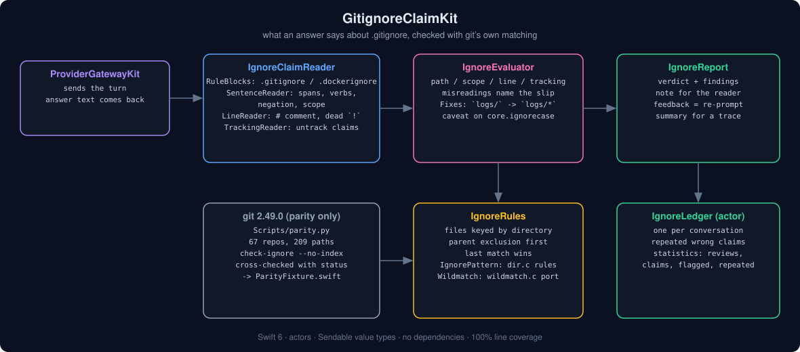
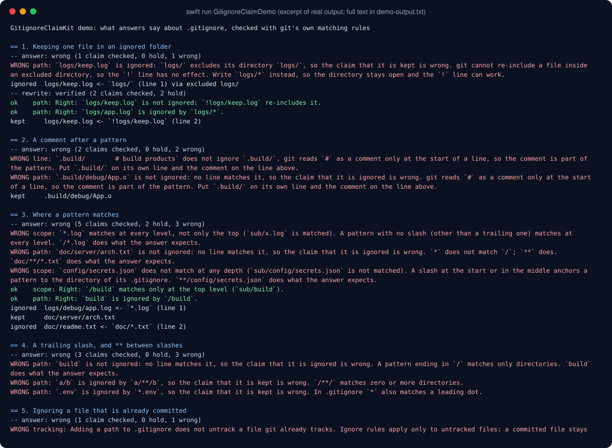
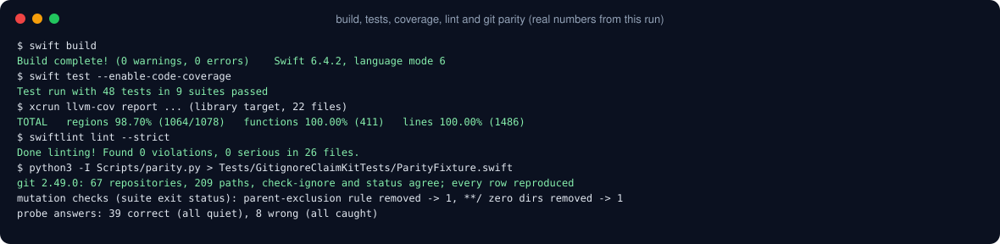

# GitignoreClaimKit



Ask a model how to keep one file in an ignored folder and it often writes `logs/` followed by
`!logs/keep.log`, then says the file stays tracked. It does not: git never looks inside an excluded
directory, so the `!` line has no effect. Ask for a starter `.gitignore` and you may get
`node_modules/  # dependencies`, which ignores nothing, because `#` starts a comment only at the start of
a line. Ask whether `doc/*.txt` covers `doc/server/arch.txt`, whether `*.log` only matches at the root, or
whether adding a committed file to `.gitignore` stops git tracking it, and the confident answer is wrong
each time.

Every one of those can be checked mechanically. GitignoreClaimKit reads what an answer says about ignore
rules, in its prose and in the `.gitignore` it shows, and applies git's own matching to each claim: a
byte-for-byte port of git's `wildmatch.c` plus the rules of `dir.c` (anchoring, directory-only lines,
last match wins, nothing below an excluded directory comes back, nested `.gitignore` files). It says
which claims hold, which are wrong, the mistake behind each wrong one, and a line that does what the
answer meant.

## Why

The series' claim checkers recompute what an answer works out on its own: dates, arithmetic, units,
regexes, strings, JSON, YAML, TOML, SQL and version ranges. Ignore rules are the same kind of claim. They
are short, they look obvious, and the cost of a wrong one shows up later: a secret that was meant to be
ignored gets committed, or a file that was meant to stay tracked silently drops out of the repository.
git ships the reference implementation, so the answer can be checked exactly rather than by opinion.

## What it checks

| Claim | Example | How it is read |
|---|---|---|
| A path is (or is not) ignored | "This keeps `logs/keep.log` tracked", "`build/out.o` is ignored" | against the answer's `.gitignore` |
| A pattern matches a path | "`doc/*.txt` matches `doc/server/arch.txt`" | against the patterns the sentence names |
| Where a pattern matches | "`*.log` only matches at the root", "`config/secrets.json` matches at any depth" | a sample path at the top and one level down |
| A line works as written | `*.tmp # temp files` in a `.gitignore` block | implied by the line |
| A negated path comes back | `!logs/keep.log` under `logs/` | implied by the line |
| `.gitignore` untracks a file | "add it to .gitignore and git will stop tracking it" | the sentence |

Nested `.gitignore` files apply to their own directory ("put this in `logs/.gitignore`"). Another tool's
ignore file (`.dockerignore`, `.npmignore`, `.eslintignore`, ...) is recognised and its claims are reported
as not checked, because those tools do not follow git's rules.

### The slips it names

| Slip | Example |
|---|---|
| `reincludeUnderExcludedDirectory` | `logs/` then `!logs/keep.log`; the fix is `logs/*` |
| `trailingComment` | `*.log  # logs` read as `*.log` plus a comment |
| `directoryOnly` | `build/` said to ignore a file named `build` |
| `slashAnchors` | `doc/*.txt` or `config/secrets.json` said to match at any depth |
| `slashlessMatchesEverywhere` | `*.log` or `build/` said to match only at the top level |
| `starStopsAtSlash` | `doc/*.txt` said to match `doc/server/arch.txt` |
| `doubleStarMatchesZero` | `a/**/b` said not to match `a/b` |
| `starMatchesDotfiles` | `*.env` said to skip `.env` |
| `lastMatchWins` | `!important.log` placed before `*.log` |
| `letterCase` | `*.LOG` said to ignore `app.log` on a case-sensitive repository |
| `alreadyTracked` | `.gitignore` said to untrack a file git already tracks |

A claim that holds only under one `core.ignorecase` setting is a caveat when the policy does not say which
(`git init` turns it on for a case-insensitive file system, as on macOS and Windows).

## Install

```swift
.package(url: "https://github.com/rajatslakhina/gitignore-claim-kit.git", from: "1.0.0")
```

and `.product(name: "GitignoreClaimKit", package: "gitignore-claim-kit")` in your target. Swift 6, no
dependencies. macOS 13, iOS 16, tvOS 16, watchOS 9.

## Usage

~~~swift
import GitignoreClaimKit

let answer = """
Add this to your `.gitignore`:

```gitignore
logs/
!logs/keep.log
```

This ignores everything in `logs/` but keeps `logs/keep.log` tracked.
"""

let report = IgnoreClaimChecker().check(answer)
report.verdict      // .wrong
report.summary      // "1 claim checked, 0 hold, 1 wrong"
report.note         // "Gitignore check: `logs/keep.log` is ignored: `logs/` excludes its directory ..."
report.feedback     // a re-prompt listing what to fix
report.findings[0].fix   // "logs/*"
~~~

The rules engine is usable on its own:

```swift
let rules = IgnoreRules("logs/*\n!logs/keep.log\n")
rules.verdict(for: "logs/keep.log").isIgnored        // false
rules.verdict(for: "logs/app.log").decidingPattern   // the `logs/*` line, with its line number

let nested = IgnoreRules(files: ["": "*.tmp\n", "logs/": "*\n!.gitignore\n"])
nested.verdict(for: "logs/.gitignore").isIgnored     // false
```

A path ending in `/` is a directory. `IgnoreLedger` (an actor) checks a conversation's answers in turn and
marks a wrong claim that comes back after a correction as repeated.

### Policies

| Policy | Lines of a `.gitignore` as claims | `core.ignorecase` | Caveats |
|---|---|---|---|
| `.standard` | yes | unknown: a claim that depends on it is a caveat | reported |
| `.lenient` | no | unknown | let through |
| `.caseSensitive` | yes | `false` (Linux, CI) | reported |
| `.caseInsensitive` | yes | `true` (macOS, Windows) | reported |

## How it fits

- **ProviderGatewayKit** sends the turn; this package checks the answer that comes back. It has no
  compile-time dependency on it: run it on the reply text before the answer is shown.
- **OutputRepairKit** runs a bounded repair loop; `report.feedback` is the re-prompt.
- **ai-chat-app** runs it as the `ignoreCheck` stage after the model answers.

## Demo



`swift run GitignoreClaimDemo` runs eight scenarios: keeping one file in an ignored folder (wrong, then
the `logs/*` rewrite), a comment after a pattern, where patterns match, a trailing slash and `**`
between slashes, ignoring a file that is already committed, letter case under three policies, a nested
`.gitignore` next to a `.dockerignore`, and a conversation through an `IgnoreLedger` where one wrong claim
comes back. The full output is in [Screenshots/demo-output.txt](Screenshots/demo-output.txt); two runs
are byte-identical.

## Quality



- `swift build`: 0 warnings, 0 errors (Swift 6.4.2, language mode 6).
- `swift test --enable-code-coverage`: 48 tests in 9 suites, 0 failures.
- `llvm-cov report` on the library: **100.00% of lines (1486) and functions (411)** in all 22 files;
  regions 98.70% (1064/1078). [Screenshots/coverage.txt](Screenshots/coverage.txt) has the full report.
- `swiftlint lint --strict`: 0 violations in 26 files, with the series' `.swiftlint.yml` unchanged.
- **Parity with git.** `Scripts/parity.py` builds a throwaway repository for each of 67 cases (one or
  more `.gitignore` files, real files and directories on disk), asks `git check-ignore --no-index` about
  each of 209 paths, and cross-checks every file against `git status --porcelain --ignored -uall`; any
  disagreement stops the script. git 2.49.0 wrote `Tests/GitignoreClaimKitTests/ParityFixture.swift`, and
  every row matches. The cases cover anchoring, `**` in each position, bracket classes, escapes, trailing
  spaces, comments, negation under excluded parents, nested files and `core.ignorecase`. The tests read
  the fixture; they do not need git.
- Mutation checks on two rules, each mutant failing the suite (judged by exit status): the "nothing below
  an excluded directory comes back" rule removed, and `**/` no longer matching zero directories.
- Probed before tagging with 39 correct answers (an Xcode `.gitignore` template with section comments,
  "won't stop tracking it", advice such as "use `/build` rather than `build`", a `.dockerignore`, a
  question, a block introduced as "this doesn't work") and 8 wrong ones. The correct answers raise
  nothing and every wrong one is caught; both sets are kept as a test.

## Limits

- Only code spans are read: "the logs folder" in plain prose is not a path. A path written without a
  trailing slash that reads differently as a file and as a directory (`build` against `build/`) is not
  checked unless the sentence says "file" or "folder".
- Global excludes (`core.excludesFile`, `.git/info/exclude`) are not modelled; their claims are read
  against the root `.gitignore` shown, if any.
- "Everything in `logs/`" and "the contents of `logs/`" are not turned into claims, and neither is a
  pattern named after "unlike", "rather than" or "instead of".
- A clause is read only up to "if", "unless", "when" or "otherwise", and advice ("should", "to ignore",
  "can") is not a claim: these keep answers quiet, at the cost of missing a claim phrased that way.
- `.gitignore` claims made through `git check-ignore -v` or `git status` output are not read.
- `alreadyTracked` is judged from the sentence alone. An answer that mentions `git rm --cached` anywhere
  is taken to know the rule.

## Part of a series

One of a set of Swift packages around
[ProviderGatewayKit](https://github.com/rajatslakhina/foundation-model-provider-gateway); the
[umbrella demo](https://github.com/rajatslakhina/llm-ecosystem-demo) runs them together and
[ai-chat-app](https://github.com/rajatslakhina/ai-chat-app) uses them in a real send pipeline.

MIT license.
